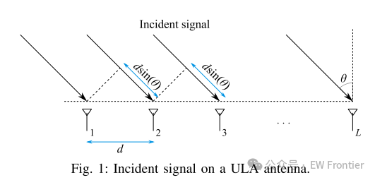
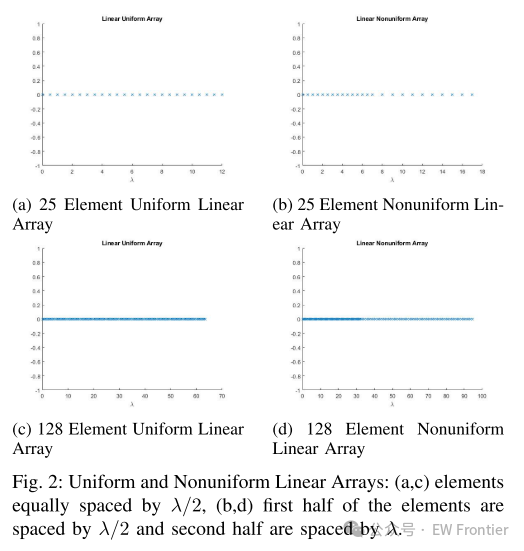
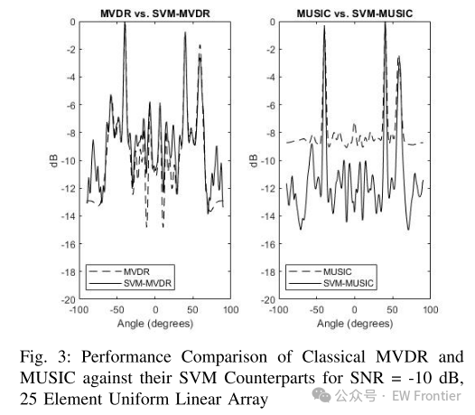
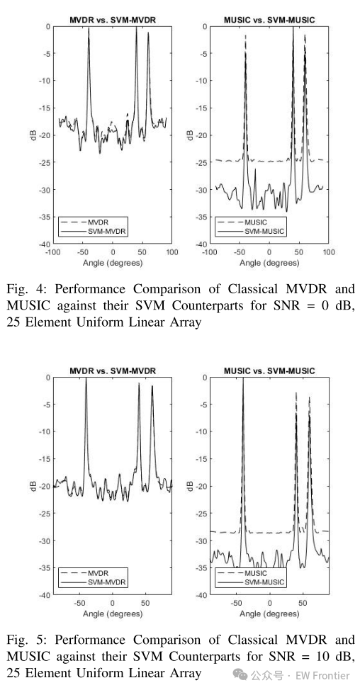
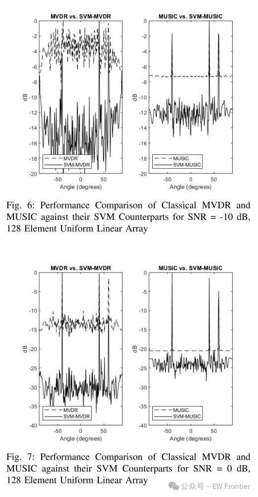
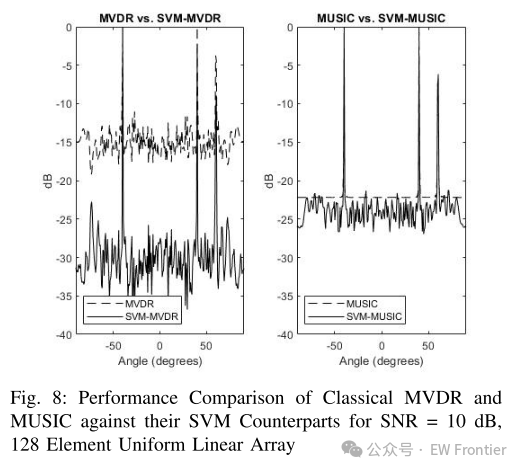

# DOA Estimation with Support Vector Machine MUSIC Algorithm [with MATLAB Code]

In this project, we will study the work of ElGonnouni et al. [1] in developing robust direction of arrival (DoA) estimation. We present a mathematical relationship between the minimum variance unbiased response (MVDR) and multi-signal classification (MUSIC) DoA algorithms. Subsequently, we introduce the SVM extensions of these techniques and compare the results across all four variants.
Introduction
Over the past decade, sensor array processing has been widely studied in the literature. Due to its wide applications, it has attracted significant attention. For example, it can be used for source localization, target detection, and spatial spectrum estimation problems. The research on this topic still holds significant importance because firstly, new challenges arise that need to be addressed. These include handling system nonlinearity, equation regularization, and model compatibility with different noise types and sources. Secondly, in the era of 5G involving the Internet of Things (IoT) and dense photonics concepts, interference has become a significant issue. A promising solution to such problems is to utilize sensor array processing in source localization environments to limit full-directional transmission for interference mitigation. Besides addressing the critical concerns regarding potential health hazards due to significantly increased electromagnetic wave emission nodes, this also has some other considerations for enhancing communication system performance.
Simulate the arrival direction (DoA) of received signals. However, various DoA estimation techniques have been discussed in the literature, and this paper focuses on multiple signal classification (MUSIC) algorithm. We will discuss multiple variants of MUSIC algorithms and highlight their similarities and differences. The discussion will start with the minimum variance unbiased response (MVDR) algorithm, which is considered a generalization of the MUSIC algorithm. After emphasizing the differences between the classic MUSIC and MVDR techniques, we propose versions of these two technologies using Support Vector Machines (SVM).
Conclusion
End

## Images

<!-- PAYMENT_BLOCK -->

## Get this dataset

- Payment link (Stripe): [Buy now](https://buy.stripe.com/3cs8yP7sY87d0vu9AB)
- Payment QR code: 

<!-- /PAYMENT_BLOCK -->
